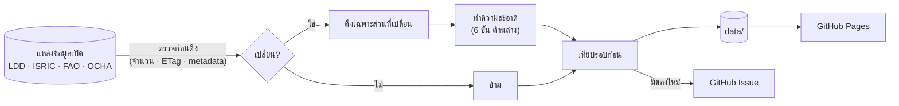
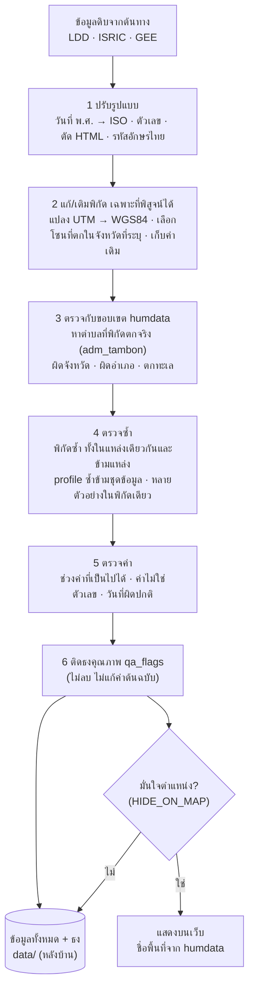

# ฐานข้อมูลดินไทย (Thai Soil Database)

ระบบรวบรวมข้อมูลดินจากแหล่งข้อมูลเปิดของประเทศไทยไว้บนแผนที่เดียว ตรวจหาข้อมูลใหม่อัตโนมัติทุกเดือน ทำความสะอาดข้อมูลอย่างโปร่งใส
แสดงเฉพาะข้อมูลที่มั่นใจตำแหน่ง และมีฟังก์ชันตรวจดินจากพิกัดสำหรับผู้ใช้ทั่วไป

**ข้อมูลดิน** (เรียงจากเชื่อถือได้มากไปน้อย)

| แหล่ง | ข้อมูล | สัญญาอนุญาต |
|---|---|---|
| ISRIC – WoSIS | soil profile แยกชั้นความลึก ผลแล็บ (pH, OC, N, เนื้อดิน, CEC, BD) | CC BY / CC0 / PD ต่อชุดข้อมูล |
| กรมพัฒนาที่ดิน – การตรวจวิเคราะห์ดิน (osd01) | ผลวิเคราะห์ดินจากห้องแล็บเป็นตัวเลข (pH, EC, OM, P, K) | CC BY |
| กรมพัฒนาที่ดิน – Soil Survey Public | จุดสำรวจภาคสนาม (ระดับ pH/OM/P/K, เนื้อดิน) | ไม่ระบุ © LDD |
| กรมพัฒนาที่ดิน – บัตรดินดี (osd02) | ผลตรวจดินของเกษตรกร สรุประดับตำบล | CC BY |
| SoilGrids, OpenLandMap, FAO GSOCmap | แผนที่ดินโลก (ค่าประมาณจากแบบจำลอง) | CC BY / CC BY-SA |

**ชั้นพื้นที่**

| แหล่ง | ข้อมูล | สัญญาอนุญาต |
|---|---|---|
| OCHA / กรมแผนที่ทหาร (COD-AB) | ขอบเขตจังหวัด อำเภอ ตำบล — ใช้ตรวจพิกัดด้วย | CC BY-IGO |
| Esri / Impact Observatory | การใช้ที่ดิน Sentinel-2 10 m รายปี | CC BY 4.0 |
| กรมพัฒนาที่ดิน – ชุดดิน กลุ่มชุดดิน การใช้ที่ดิน | ให้เฉพาะลิงก์ (สัญญาอนุญาตห้ามดัดแปลง) | CC BY-NC-ND |

รายชื่อแหล่งทั้งหมด (รวมที่กำลังจะเพิ่ม) อยู่ที่ [docs/sources.md](docs/sources.md) และหน้า **แหล่งข้อมูล** บนเว็บไซต์

- 🌐 **เว็บไซต์**: <https://navavit.github.io/thai-soil-db/> มีทั้งภาษาไทยและอังกฤษ (`?lang=en`) ประกอบด้วยแผนที่ชั้นข้อมูลดิน แผนที่ดิน ขอบเขตปกครอง การใช้ที่ดิน และการตรวจดินจากพิกัด
- 🔄 **อัปเดต**: GitHub Actions รันวันที่ 1 ของทุกเดือน และเปิด Issue แจ้งเตือนเมื่อพบข้อมูลใหม่

## การไหลของข้อมูล



### ขั้นตอนทำความสะอาดข้อมูล



- แผนภาพฉบับเต็มและ **ER diagram**: [docs/architecture.md](docs/architecture.md)
- **วิธีทำความสะอาดข้อมูล** (ทุกขั้นตอน พร้อมตัวเลขจากข้อมูลจริง): [docs/data-cleaning.md](docs/data-cleaning.md)

## โครงสร้างโฟลเดอร์

```
.
├── .github/workflows/
│   ├── update-data.yml        # ตรวจข้อมูลใหม่ทุกแหล่งรายเดือน → commit → Issue → deploy
│   └── pages.yml              # สร้างไฟล์สำหรับเว็บ (build_web.py) แล้ว deploy ขึ้น GitHub Pages
├── scripts/
│   ├── fetch_ldd.py           # จุดสำรวจภาคสนาม LDD
│   ├── fetch_osd.py           # ผลวิเคราะห์ดินจากห้องแล็บ LDD
│   ├── fetch_wosis.py         # soil profile จาก ISRIC WoSIS
│   ├── fetch_dindee.py        # บัตรดินดี LDD
│   ├── sample_gee.py          # สุ่มค่าแผนที่ดินโลกจาก Google Earth Engine ที่จุดข้อมูล
│   ├── admin.py               # ขอบเขตปกครอง humdata: หาตำบลจากพิกัด, จับคู่ชื่อพื้นที่, ตรวจพิกัดซ้ำ
│   ├── build_boundaries.py    # ย่อขอบเขตจังหวัด/อำเภอ/ตำบลจาก COD-AB
│   ├── build_rasters.py       # ส่งออกแผนที่ดินจาก GEE เป็นภาพทั้งประเทศ (จัดชั้นด้วย site/scales.js)
│   ├── build_web.py           # แบ่งข้อมูลเป็นกริด 0.5° + ชื่อพื้นที่ + บัตรดินดีตามรหัส humdata
│   ├── check_static_sources.py # ตรวจฉบับใหม่ของแหล่งอ้างอิงจาก metadata
│   └── check_landuse.py       # ตรวจปีสำรวจการใช้ที่ดิน LDD รายจังหวัด (metadata เท่านั้น)
├── data/                      # ข้อมูลที่ระบบสร้าง (อย่าแก้ด้วยมือ)
│   ├── ldd/  osd/  wosis/  dindee/  gee/   # ข้อมูลแต่ละแหล่ง พร้อม meta.json / changelog.json / state.json
│   ├── ref/
│   │   ├── boundaries/        # ขอบเขตปกครอง humdata (ย่อรูป) ใช้ทั้งบนเว็บและตรวจพิกัด
│   │   ├── rasters/           # ภาพแผนที่ดิน OpenLandMap / FAO GSOCmap
│   │   ├── sources_state.json # รุ่นล่าสุดของแหล่งอ้างอิง
│   │   └── landuse_state.json # ปีสำรวจการใช้ที่ดิน LDD ของแต่ละจังหวัด
│   └── web/                   # (ไม่ commit) สร้างตอน deploy
├── site/                      # เว็บไซต์สองภาษา (Leaflet)
│   ├── app.js  areas.js  check.js   # ชั้นข้อมูลดิน · ชั้นพื้นที่และแผนที่ดิน · ตรวจดินจากพิกัด
│   ├── scales.js              # ช่วงชั้นและชุดสีของทุกค่า ใช้ร่วมกันทั้งระบบ
│   └── i18n.js  sources.js    # ข้อความไทย/อังกฤษ · รายชื่อแหล่งข้อมูล
└── docs/
    ├── architecture.md        # แผนภาพระบบ
    ├── data-cleaning.md       # วิธีทำความสะอาดข้อมูล
    └── sources.md             # รายชื่อแหล่งข้อมูลดินแบบเปิด
```

## หลักการทำงาน

- **ตรวจก่อนดึง** — ดูจำนวนจุด, ETag หรือ metadata ที่ต้นทางก่อน ดึงเฉพาะส่วนที่เปลี่ยน ไม่ให้เซิร์ฟเวอร์ต้นทางรับภาระหนัก
- **ไม่แก้ค่าต้นฉบับ** — ข้อมูลที่ผิดปกติถูกติดธงคุณภาพ (`qa_flags`) แทนการลบหรือแก้ และบันทึกการเปลี่ยนแปลงทุกรอบ
- **ขอบเขตปกครองชุดเดียว** — ทุกชั้นใช้ขอบเขตจังหวัด/อำเภอ/ตำบลของ humdata (COD-AB) ทั้งตรวจว่าพิกัดอยู่ในพื้นที่ที่ระบุ และเป็นชื่อพื้นที่ที่แสดงบนเว็บ ไม่ใช้ชื่อหรือขอบเขตจากแต่ละแหล่ง
- **แสดงเฉพาะที่มั่นใจ** — ข้อมูลที่พิกัดซ้ำ ผิดจังหวัด ตกทะเล หรือไม่ระบุสถานที่ ไม่ขึ้นเว็บ แต่ยังเก็บไว้หลังบ้านพร้อมธง
- **เรียงตามความน่าเชื่อถือ** — WoSIS → ผลวิเคราะห์จากห้องแล็บ → จุดสำรวจภาคสนาม และแยกชนิดข้อมูลชัดเจน (ค่าวัด / ค่าระดับ / ค่าประมาณจากแบบจำลอง)
- **ช่วงชั้นและสีเดียวกันทั้งระบบ** — เกณฑ์ของ LDD (pH 11 ระดับ, ความอุดมสมบูรณ์ 3 ระดับ) และชุดสี ColorBrewer ใช้ร่วมกันทั้งจุด แผนที่ดิน และคำอธิบายสี
- **ตรวจดินจากพิกัด** — ค่าวัดจริงที่อยู่ใกล้ (โหลดเฉพาะบริเวณ), ค่าประมาณ SoilGrids ที่จุดนั้น และบัตรดินดีของตำบล (humdata) ทำงานในเบราว์เซอร์ทั้งหมด ไม่มีเซิร์ฟเวอร์ของตัวเอง
- **เคารพสัญญาอนุญาต** — เผยแพร่เฉพาะข้อมูลที่อนุญาตให้เผยแพร่ต่อ ชุดที่ห้ามดัดแปลง (ND) ให้เฉพาะลิงก์ และเฝ้าดูฉบับใหม่จาก metadata
- **ติดตามรอบสำรวจการใช้ที่ดิน** — LDD สำรวจหมุนเวียนปีละ ~12–16 จังหวัด และเว็บต้นทางมีเฉพาะฉบับล่าสุด ระบบบันทึกปีสำรวจของแต่ละจังหวัดและแจ้งเมื่อมีฉบับใหม่
- **ไม่มีค่าใช้จ่าย** — ใช้เฉพาะบริการฟรีและข้อมูลเปิด (GitHub Pages/Actions สำหรับ repo สาธารณะ, Earth Engine แบบไม่เชิงพาณิชย์)

## ข้อควรทราบ

- ข้อมูลเป็นสิทธิ์ของหน่วยงานต้นทาง (กรมพัฒนาที่ดิน, ISRIC, FAO, OCHA/กรมแผนที่ทหาร, Esri/Impact Observatory) repo นี้เป็นสำเนาเพื่อการศึกษาและวิเคราะห์
- ความหมายของวันที่ต่างกันตามแหล่ง (ปีสำรวจ, วันที่ส่งผลวิเคราะห์, วันที่สำรวจภาคสนาม) ดูคำอธิบายบนเว็บไซต์หัวข้อ "วันที่และความใหม่ของข้อมูล"
- จุดสำรวจภาคสนามของ LDD เป็น **ค่าระดับ** (เช่น "กรดจัด", "ต่ำ") ไม่ใช่ตัวเลข พิกัดบางส่วนแปลงจาก UTM โดยเลือกโซนที่ทำให้จุดตกในจังหวัดที่ระบุ (ตามขอบเขต humdata) สมมติ datum WGS84 ถ้าต้นทางใช้ Indian 1975 อาจคลาดเคลื่อน 300–400 ม.
- แผนที่ดินโลก (SoilGrids, OpenLandMap, FAO) เป็นค่าประมาณจากแบบจำลอง ไม่ใช่ค่าวัด
