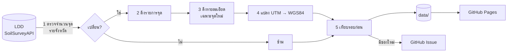

# ฐานข้อมูลจุดสำรวจดินไทย (Thai Soil Survey Database)

ระบบรวบรวมข้อมูลดินจากแหล่งข้อมูลเปิดของประเทศไทย ตรวจหาข้อมูลใหม่อัตโนมัติทุกเดือน ทำความสะอาดข้อมูลอย่างโปร่งใส และแสดงผลเป็นแผนที่บนเว็บไซต์

| แหล่ง | ข้อมูล | สัญญาอนุญาต |
|---|---|---|
| กรมพัฒนาที่ดิน – Soil Survey Public | จุดสำรวจดิน (ระดับ pH/OM/P/K, เนื้อดิน) | ไม่ระบุ © LDD |
| กรมพัฒนาที่ดิน – การตรวจวิเคราะห์ดิน (osd01) | ผลวิเคราะห์ดินเป็นตัวเลข (pH, EC, OM, P, K) | CC BY |
| กรมพัฒนาที่ดิน – ข้อมูลบัตรดินดี (osd02) | ผลวิเคราะห์ดินของเกษตรกร ระดับตำบล (pH/N/P/K เป็นระดับ) | CC BY |
| ISRIC – WoSIS | soil profile แยกชั้นความลึก ผลแล็บ (pH, OC, N, เนื้อดิน, CEC, BD) | CC BY / CC0 / PD ต่อชุดข้อมูล |
| Google Earth Engine – OpenLandMap, SoilGrids, FAO GSOCmap | ค่าคุณสมบัติดินและคาร์บอนในดินที่จุดสำรวจ (ใช้เทียบ) | CC BY-SA / CC BY |

รายชื่อแหล่งทั้งหมด (รวมที่กำลังจะเพิ่ม) อยู่ที่ [docs/sources.md](docs/sources.md) และหน้า **แหล่งข้อมูล** บนเว็บไซต์

- 🌐 **เว็บไซต์**: <https://navavit.github.io/thai-soil-db/> มีทั้งภาษาไทยและอังกฤษ (`?lang=en`) ประกอบด้วยแผนที่ ตัวกรอง ตาราง และดาวน์โหลด
- 📥 **ดาวน์โหลด**: [`points.csv`](data/ldd/points.csv) · [`points.geojson`](data/ldd/points.geojson) · [`points.json`](data/ldd/points.json)
- 🔄 **อัปเดต**: GitHub Actions รันวันที่ 1 ของทุกเดือน และเปิด Issue แจ้งเตือนเมื่อพบข้อมูลใหม่

## การไหลของข้อมูล



- แผนภาพฉบับเต็มและ **ER diagram**: [docs/architecture.md](docs/architecture.md)
- **วิธีทำความสะอาดข้อมูล** (ทุกขั้นตอน พร้อมตัวเลขจากข้อมูลจริง): [docs/data-cleaning.md](docs/data-cleaning.md)

## โครงสร้างโฟลเดอร์

```
.
├── README.md
├── .github/workflows/
│   ├── update-data.yml     # ตรวจข้อมูลใหม่รายเดือน → commit → Issue → deploy
│   └── pages.yml           # deploy เว็บไซต์ขึ้น GitHub Pages
├── scripts/
│   ├── fetch_ldd.py        # จุดสำรวจดิน LDD (Python stdlib ล้วน)
│   ├── fetch_osd.py        # ผลวิเคราะห์ดิน LDD (Python stdlib ล้วน)
│   ├── fetch_wosis.py      # soil profile จาก ISRIC WoSIS (Python stdlib ล้วน)
│   ├── fetch_dindee.py     # ข้อมูลบัตรดินดี LDD (Python stdlib ล้วน)
│   ├── build_web.py        # แบ่งข้อมูลเป็นกริด 0.5° สำหรับฟังก์ชันตรวจดินบนเว็บ (สร้างตอน deploy)
│   └── sample_gee.py       # สุ่มค่าจาก Google Earth Engine (ต้องใช้ earthengine-api)
├── data/                   # ข้อมูลที่ระบบสร้าง (อย่าแก้ด้วยมือ)
│   ├── meta.json           # สรุปการอัปเดตล่าสุด
│   ├── changelog.json      # ประวัติทุกรอบ
│   ├── changes/            # รายการเพิ่ม/ลบ/แก้ไขแต่ละรอบ
│   ├── ldd/
│   │   ├── points.json     # ข้อมูลหลัก
│   │   ├── points.geojson
│   │   ├── points.csv
│   │   └── state.json      # จำนวนจุดรายจังหวัด (ใช้ตรวจก่อนดึง)
│   ├── osd/                # ผลวิเคราะห์ดิน: sites_<ปี>.json, sites.csv, measurements_<ปี>.csv.gz, state.json
│   ├── wosis/              # profiles.json, profiles.csv, layers.csv
│   ├── dindee/             # samples.csv, by_tambon.csv
│   ├── gee/                # covariates.csv (ค่าจาก GEE ที่แต่ละจุด)
│   └── web/                # (ไม่ commit) ไฟล์กริดที่ build_web.py สร้างตอน deploy
├── site/                   # เว็บไซต์สองภาษา (HTML/CSS/JS + Leaflet, i18n.js)
├── docs/
│   ├── architecture.md     # flowchart + ER diagram
│   ├── data-cleaning.md    # วิธีทำความสะอาดข้อมูล
│   └── sources.md          # รายชื่อแหล่งข้อมูลดินแบบเปิด
└── notebooks/              # Jupyter สำหรับวิเคราะห์ (เก็บในเครื่อง ไม่ขึ้น GitHub)
```

## หลักการทำงาน

- **ตรวจก่อนดึง** — นับจำนวนจุดที่ต้นทางก่อน ดึงเฉพาะส่วนที่เปลี่ยน เพื่อไม่ให้เซิร์ฟเวอร์ต้นทางรับภาระหนัก
- **ค่อย ๆ ดึงย้อนหลัง** — ข้อมูลเก่าที่มีจำนวนมากถูกดึงทีละส่วนในแต่ละรอบ จนครบ
- **ไม่แก้ค่าต้นฉบับ** — ข้อมูลที่ผิดปกติถูกติดธงคุณภาพ (`qa_flags`) แทนการลบหรือแก้
- **บันทึกทุกการเปลี่ยนแปลง** — แต่ละรอบเทียบกับรอบก่อน แล้วเก็บรายการเพิ่ม/ลบ/แก้ไข
- **เคารพสัญญาอนุญาต** — เผยแพร่เฉพาะข้อมูลที่สัญญาอนุญาตให้เผยแพร่ต่อ ชุดที่ห้ามดัดแปลง (ND) ให้เฉพาะลิงก์
- **ตรวจดินจากพิกัด** — เว็บรวมค่าวัดจริงที่อยู่ใกล้ (จากไฟล์กริดที่โหลดเฉพาะบริเวณ) ค่าประมาณจาก SoilGrids ที่จุดนั้น และบัตรดินดีของตำบล (หาชื่อตำบลจาก OpenStreetMap) ทั้งหมดทำงานในเบราว์เซอร์ ไม่มีเซิร์ฟเวอร์ของตัวเอง
- **อัปเดตอัตโนมัติ** — GitHub Actions รันทุกเดือน แจ้งเตือนผ่าน Issue และ deploy เว็บไซต์ใหม่

## ข้อควรทราบ

- ข้อมูลเป็นสิทธิ์ของ **กรมพัฒนาที่ดิน** repo นี้เป็นสำเนาเพื่อการศึกษาและวิเคราะห์ ใช้เฉพาะ API สาธารณะแบบอ่านอย่างเดียว และหน่วงเวลาระหว่างคำขอ
- แต่ละจุดมีวันที่ 4 แบบ: `date` (วันสำรวจภาคสนาม), `first_seen` (วันที่เก็บเข้าระบบ), `last_seen` (พบล่าสุดที่ต้นทาง), `detail_fetched_at` (วันที่ดึงรายละเอียด)
- ค่า pH / OM / P / K จากแหล่งนี้เป็น **ระดับ** (เช่น "กรดจัด", "ต่ำ") ไม่ใช่ค่าตัวเลข
- จุดที่ไม่มี lat/lon แต่มีพิกัด UTM ถูกแปลงเป็น WGS84 (`coord_source = utm`) โดยสมมติ datum WGS84 บางจุดระบุโซนผิด ระบบเลือกโซนที่ใกล้จังหวัดของจุดนั้นที่สุด (`utm_zone_fixed`) ถ้าข้อมูลต้นทางใช้ Indian 1975 พิกัดอาจคลาดเคลื่อนประมาณ 300–400 ม.
