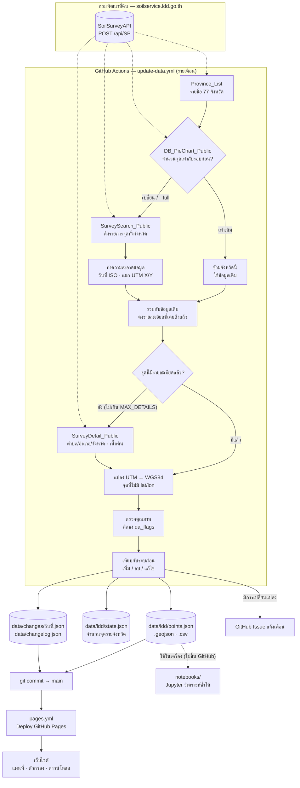
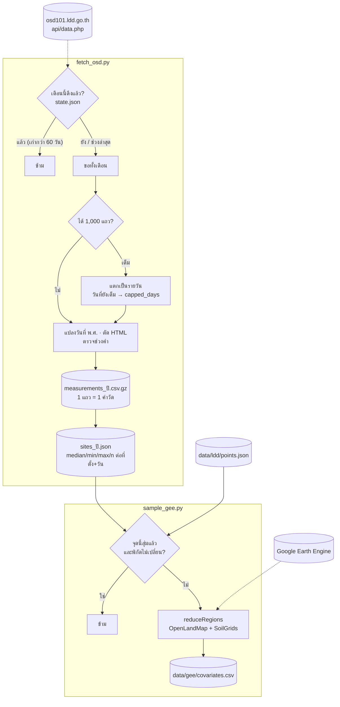
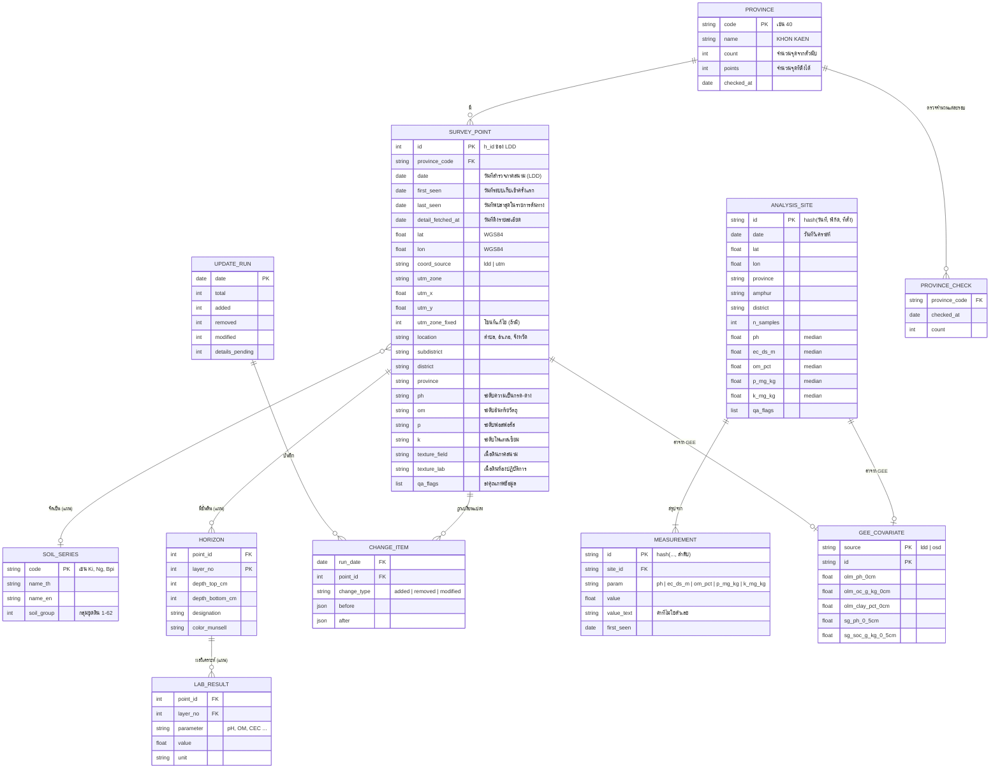

# สถาปัตยกรรมระบบ

## 1. การไหลของข้อมูล (Data flow)

### ผลวิเคราะห์ดิน (osd101) และ Google Earth Engine

### หลักการไม่ดึงข้อมูลซ้ำ

1. **ตรวจจำนวนก่อน**: เรียก `DB_PieChart_Public` ซึ่งตอบกลับขนาดเล็ก ผลรวมของ `data3` เท่ากับจำนวนจุดในจังหวัด ถ้าเท่ากับค่าใน `state.json` จะข้ามจังหวัดนั้น
2. **รายละเอียดดึงครั้งเดียว**: `SurveyDetail_Public` เรียกเฉพาะจุดที่ยังไม่มีฟิลด์ `province` และจำกัดจำนวนต่อรอบด้วย `MAX_DETAILS`
3. **ตรวจแบบเต็มปีละครั้ง** (รอบเดือนมกราคม) หรือสั่งเองด้วย `full=true` เพื่อจับการแก้ไขข้อมูลที่ไม่ได้เปลี่ยนจำนวนจุด

## 2. ER diagram

ตอนนี้ข้อมูลเก็บเป็นไฟล์ JSON/CSV ใน `data/` โครงสร้างด้านล่างคือแบบจำลองเชิงตรรกะ ซึ่งนำไปสร้างตารางใน PostGIS/SQLite ได้ตรงตัว ตารางที่มีคำว่า *(แผน)* ยังไม่ได้ดึงข้อมูล

### การจัดการข้อมูลไม่สะอาด (Data quality)

ข้อมูลต้นทางมีปัญหาหลายแบบ ระบบ **ไม่ลบและไม่แก้ค่าต้นฉบับ** แต่จะติดธงไว้ใน `qa_flags` ให้ผู้ใช้กรองเอง สรุปจำนวนแต่ละธงอยู่ใน `data/meta.json` → `qa`

| ธง | ความหมาย | ตัวอย่างที่พบ (ขอนแก่น) |
|---|---|---|
| `no_coords` | ไม่มีพิกัดที่ใช้ได้ | ไม่มีทั้ง lat/lon และ UTM |
| `utm_converted` | lat/lon ว่าง แต่แปลงได้จาก UTM | ประมาณ 57% ของจุด |
| `utm_zone_fixed` | โซน UTM ที่ระบุไม่ตรงกับค่า X | ระบุ 47 แต่ค่า X อยู่ในโซน 48 |
| `far_from_province` | ห่างจากค่ากลางของจังหวัดเกิน ~150 km | |
| `province_mismatch` | จังหวัดใน `location` ไม่ตรงกับจังหวัดที่ค้นหา | |
| `no_location` | ไม่มีชื่อตำแหน่ง | |
| `date_missing` / `date_future` / `date_too_old` | วันที่ผิดปกติ | |
| `ph_unknown` / `nutrient_unknown` | ค่าเป็น `Other` หรือว่าง | |
| `duplicate` | พิกัดและวันที่ซ้ำกับจุดอื่น (จุดที่ id น้อยกว่าไม่ถูกติดธง) | |

การตรวจสอบเพิ่มเติม: lat/lon ที่ LDD ให้มาตรงกับค่า UTM ภายใน 1 km ทุกจุด (350/350) ปัญหาจึงอยู่ที่ฟิลด์โซนของจุดที่ไม่มี lat/lon

### วันที่ของข้อมูลแต่ละจุด

| ฟิลด์ | ความหมาย | ที่มา |
|---|---|---|
| `date` | วันที่ลงพื้นที่เก็บตัวอย่างดิน | LDD |
| `first_seen` | วันที่ระบบนี้พบจุดครั้งแรก (ไม่เปลี่ยนอีก) | ระบบนี้ |
| `last_seen` | วันที่ล่าสุดที่จุดยังปรากฏในรายการของ LDD | ระบบนี้ |
| `detail_fetched_at` | วันที่ดึงรายละเอียด (ตำบล/อำเภอ/เนื้อดิน) | ระบบนี้ |

ฟิลด์ของระบบไม่นับเป็น "การแก้ไขข้อมูล" ตอนเทียบรอบ

### ไฟล์ที่สอดคล้องกับแต่ละ entity

| Entity | ไฟล์ |
|---|---|
| `SURVEY_POINT` | `data/ldd/points.json`, `points.geojson`, `points.csv` |
| `PROVINCE` / `PROVINCE_CHECK` | `data/ldd/state.json` |
| `UPDATE_RUN` | `data/changelog.json` |
| `CHANGE_ITEM` | `data/changes/<date>.json` |
| `ANALYSIS_SITE` | `data/osd/sites_<ปี>.json`, `sites.csv` |
| `MEASUREMENT` | `data/osd/measurements_<ปี>.csv.gz` |
| `GEE_COVARIATE` | `data/gee/covariates.csv` |
