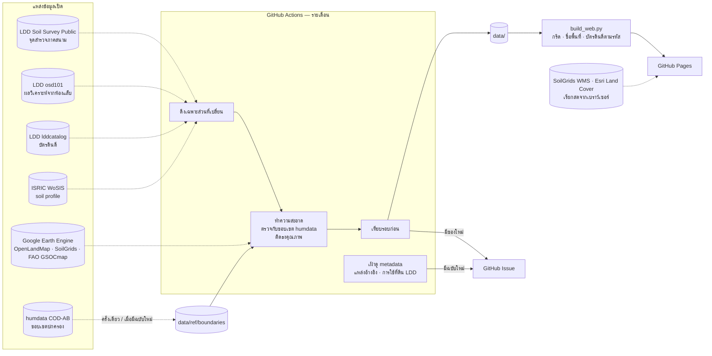
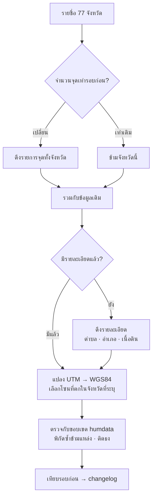
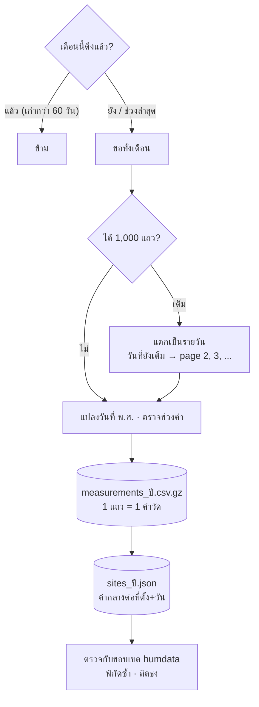
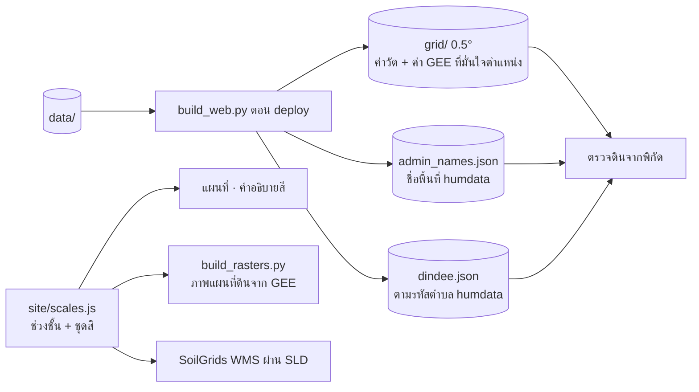
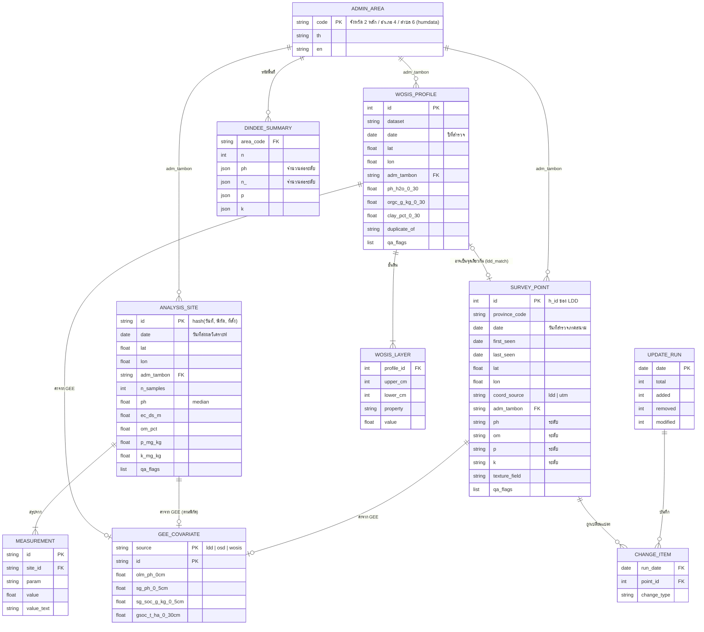

# สถาปัตยกรรมระบบ

## 1. ภาพรวม

หลักสำคัญ:

1. **ตรวจก่อนดึง** — นับจำนวนจุด, ETag/Last-Modified หรือ metadata ก่อน ดึงเฉพาะส่วนที่เปลี่ยน
2. **ไม่แก้ค่าต้นฉบับ** — ติดธง `qa_flags` แทนการลบหรือแก้ แก้เฉพาะที่พิสูจน์ได้และเก็บค่าเดิมไว้
3. **ขอบเขตปกครองชุดเดียว** — ทุกแหล่งตรวจพิกัดและได้ชื่อพื้นที่จากขอบเขต humdata (`adm_tambon`)
4. **เว็บแสดงเฉพาะที่มั่นใจตำแหน่ง** — ข้อมูลอื่นยังอยู่ใน `data/` พร้อมธง

## 2. การไหลของข้อมูลแต่ละแหล่ง

### จุดสำรวจภาคสนาม (`fetch_ldd.py`)

### ผลวิเคราะห์จากห้องแล็บ (`fetch_osd.py`)

### แหล่งอื่น

| สคริปต์ | วิธีไม่ดึงซ้ำ | ทำความสะอาด |
|---|---|---|
| `fetch_wosis.py` | เทียบ hash ราย profile | ตัดชุดข้อมูล NC/ND, ตัด profile ซ้ำข้ามชุดข้อมูล, เฉลี่ยถ่วงความหนา 0–30 cm, ขอบเขต humdata |
| `fetch_dindee.py` | ETag / Last-Modified ของไฟล์ | แยกระดับกับช่วงค่า, จับคู่ชื่อตำบลกับรหัส humdata ตอนสร้างไฟล์เว็บ |
| `sample_gee.py` | สุ่มเฉพาะจุดใหม่ (ผลวิเคราะห์ดินใช้พิกัดเป็น key) | — |
| `check_static_sources.py`, `check_landuse.py` | อ่าน metadata / ชื่อไฟล์ท้าย ZIP เท่านั้น | — |

### เว็บไซต์

## 3. ER diagram

ข้อมูลเก็บเป็นไฟล์ JSON/CSV/Parquet ใน `data/` โครงสร้างด้านล่างคือแบบจำลองเชิงตรรกะ นำไปสร้างตารางใน PostGIS/SQLite ได้ตรงตัว

ชุดดิน กลุ่มชุดดิน และการใช้ที่ดินของ LDD (CC BY-NC-ND) ไม่อยู่ในแบบจำลองนี้ เว็บให้เฉพาะลิงก์ ระบบเก็บแค่ metadata (`data/ref/sources_state.json`, `data/ref/landuse_state.json`)

## 4. ธงคุณภาพที่ทำให้ไม่แสดงบนเว็บ

| ธง | ความหมาย |
|---|---|
| `no_coords` / `outside_thailand` | ไม่มีพิกัด หรือนอกประเทศ |
| `far_from_province` | อยู่นอกขอบเขตจังหวัดที่ระบุ (humdata) เกิน 1 km |
| `off_land` | ไม่อยู่ในจังหวัดใดและห่างฝั่งเกิน 1 km |
| `amphoe_mismatch` | อำเภอที่ระบุไม่ตรงกับพิกัด |
| `shared_coords` | พิกัดซ้ำกับข้อมูลอื่น ไม่ว่าแหล่งเดียวกันหรือต่างแหล่ง |
| `duplicate` / `multi_sample` | ข้อมูลซ้ำ หรือหลายตัวอย่างในพิกัดเดียว |
| `no_location` / `date_future` | ไม่มีชื่อสถานที่ / วันที่ในอนาคต |

รายละเอียดและตัวเลขจริงอยู่ใน [data-cleaning.md](data-cleaning.md)

## 5. ไฟล์ที่สอดคล้องกับแต่ละ entity

| Entity | ไฟล์ |
|---|---|
| `ADMIN_AREA` | `data/ref/boundaries/` |
| `SURVEY_POINT` | `data/ldd/points.json` (`.geojson`, `.csv`), `state.json` |
| `ANALYSIS_SITE` / `MEASUREMENT` | `data/osd/sites_<ปี>.json`, `measurements_<ปี>.csv.gz` |
| `WOSIS_PROFILE` / `WOSIS_LAYER` | `data/wosis/profiles.json`, `layers.csv` |
| `DINDEE_SUMMARY` | `data/dindee/` (สรุปตามรหัส humdata สร้างตอน deploy) |
| `GEE_COVARIATE` | `data/gee/covariates.csv` |
| `UPDATE_RUN` / `CHANGE_ITEM` | `data/changelog.json`, `data/changes/<date>.json` |
