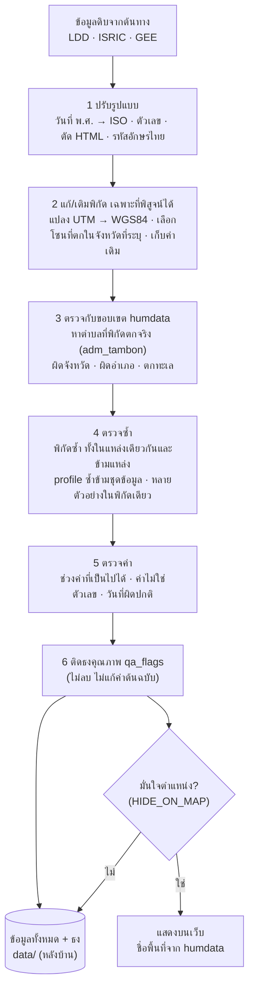

# วิธีทำความสะอาดข้อมูล (Data cleaning)

เอกสารนี้อธิบายทุกขั้นตอนที่ระบบทำกับข้อมูลดิบก่อนเผยแพร่ เพื่อให้ตรวจสอบและทำซ้ำได้

## หลักการ

1. **ไม่ลบ ไม่เดาค่า** — ทุกแถวจากต้นทางถูกเก็บไว้ ถ้ามีปัญหาจะ *ติดธง* (`qa_flags`) แทนการลบ
2. **แก้เฉพาะที่พิสูจน์ได้** — แก้ค่าเมื่อมีหลักฐานจากข้อมูลเองเท่านั้น (เช่น ค่า UTM ยืนยันได้ว่าโซนผิด) และเก็บค่าเดิมไว้เสมอ (`orig_*`, `utm_zone`, `raw_text`)
3. **เว็บแสดงเฉพาะที่มั่นใจ** — ข้อมูลที่ตำแหน่งไม่น่าเชื่อถือไม่ขึ้นแผนที่ (ดูหัวข้อ E) แต่ยังเก็บไว้ในข้อมูลหลังบ้านพร้อมธง
4. **ขอบเขตปกครองชุดเดียว** — ทุกแหล่งตรวจพิกัดและใช้ชื่อพื้นที่จากขอบเขต humdata (COD-AB) ไม่ใช้ชื่อหรือขอบเขตจากต้นทาง
5. **ทำซ้ำได้** — การทำความสะอาดทั้งหมดอยู่ในโค้ด (`scripts/fetch_*.py`, [`scripts/admin.py`](../scripts/admin.py)) และรันใหม่ทุกครั้งที่ดึงข้อมูล



---

## A. จุดสำรวจดิน (LDD Soil Survey Public)

### A1. ปรับรูปแบบ (normalise)

| ฟิลด์ต้นทาง | ปัญหา | วิธีจัดการ | ฟิลด์ผลลัพธ์ |
|---|---|---|---|
| `Date` | รูปแบบ `dd/mm/yyyy` (ค.ศ.) | แปลงเป็น ISO `yyyy-mm-dd` ถ้าแปลงไม่ได้เก็บค่าเดิม | `date` |
| `Coordinate` | ข้อความ `"X:272336.000, Y:1845479.000"` หรือ `"X:-, Y:-"` | แยกเป็นตัวเลข ค่า `-` ให้เป็น `null` | `utm_x`, `utm_y` |
| `h_lat`, `h_lon` | เป็นข้อความ บางจุดว่าง | แปลงเป็นตัวเลข ถ้าอยู่นอกกรอบประเทศไทย (lat 5–21, lon 97–106) ให้เป็น `null` | `lat`, `lon` |
| ข้อความทุกฟิลด์ | มีช่องว่างหัว/ท้าย | `strip()` ค่าว่างให้เป็น `null` | |
| `pH`, `OM`, `P`, `K` | เป็นระดับ (เช่น "กรดจัด", "ต่ำ") และมี `Other` | เก็บตามต้นทาง (ไม่แปลงเป็นตัวเลข) `Other` ติดธง | `ph`, `om`, `p`, `k` |

### A2. พิกัด — ปัญหาโซน UTM

ประเทศไทยอยู่ใน UTM โซน 47 (ตะวันตกของ 102°E) และ 48 (ตะวันออก) จังหวัดอย่างขอนแก่นคร่อมทั้งสองโซน

**สิ่งที่พบ (ขอนแก่น 902 จุด):**

| กรณี | จำนวน | สาเหตุ |
|---|---|---|
| มี lat/lon จาก LDD และถูกต้อง | 230 | — |
| มี lat/lon จาก LDD แต่ **อยู่ชายแดนพม่า (~97°E)** | 120 | LDD แปลงด้วยโซน 47 แต่ค่า X เป็นโซน 48 → แก้ได้ 117, เหลือ 3–4 จุดติดธง |
| ไม่มี lat/lon แต่มี UTM | 513 | ฟิลด์โซนระบุ 47 (หรือว่าง) แต่ค่า X เป็นโซน 48 |
| ไม่มีพิกัดเลย | 39 | — |

ตรวจสอบแล้วว่า lat/lon ของ LDD ตรงกับค่า UTM ที่ให้มาภายใน 1 km ทุกจุด (โดยใช้โซนที่ LDD ระบุ) แสดงว่า LDD แปลงถูกสูตร แต่ **ฟิลด์โซนผิด**

**วิธีแก้** (`fill_from_utm`):

1. ใช้ขอบเขตจังหวัดจริง (หัวข้อ E) วัดระยะจากพิกัดถึงจังหวัดที่ระบุ (0 ถ้าอยู่ข้างใน)
2. สำหรับจุดที่ (ก) ไม่มี lat/lon หรือ (ข) มี lat/lon แต่อยู่นอกจังหวัดที่ระบุเกิน 1 km:
   - แปลง UTM → WGS84 ด้วย **ทั้งโซน 47 และ 48**
   - ตัดผลที่อยู่นอกประเทศไทย
   - เลือกผลที่ใกล้จังหวัดที่ระบุที่สุด
3. รับผลเฉพาะเมื่อ:
   - กรณี (ข) ผลใหม่ต้องอยู่ในจังหวัด (เผื่อ 1 km) ถ้าไม่ผ่าน คงค่าเดิม แล้วจะถูกติดธง `far_from_province`
   - กรณี (ก) ผลต้องห่างจากจังหวัดไม่เกิน 50 km
4. บันทึก: `coord_source = "utm"`, โซนที่ใช้จริงใน `utm_zone_fixed`, ค่าเดิมของ LDD ใน `orig_lat`/`orig_lon`

สูตรแปลงเป็น Transverse Mercator มาตรฐาน (WGS84) ใน `utm_to_latlon()` ไม่ต้องใช้ไลบรารีภายนอก

> ⚠️ สมมติว่า datum เป็น WGS84 ถ้าข้อมูลต้นทางใช้ Indian 1975 พิกัดจะคลาดประมาณ 300–400 ม.

### A3. ธงคุณภาพ (`qa_flags`)

| ธง | เงื่อนไข | ขอนแก่น |
|---|---|---|
| `no_coords` | ไม่มี lat/lon และแปลง UTM ไม่ได้ | 39 |
| `utm_converted` | พิกัดได้จากการแปลง UTM (รวมที่แก้จาก LDD) | 630 |
| `utm_zone_fixed` | โซนที่ใช้ ≠ โซนที่ระบุ | 630 |
| `ldd_coords_fixed` | lat/lon ของ LDD ผิดโซน แก้แล้ว | 117 |
| `far_from_province` | อยู่นอกขอบเขตจังหวัดที่ระบุเกิน 1 km หลังแก้แล้ว | 8 |
| `off_land` | ไม่อยู่ในจังหวัดใดและห่างฝั่งเกิน 1 km (ตกทะเล) | 1 |
| `amphoe_mismatch` | อำเภอในรายละเอียด ≠ อำเภอที่พิกัดตก | – |
| `shared_coords` | พิกัด (5 ตำแหน่ง) ซ้ำกับจุดอื่น ไม่ว่าวันใด | 57 |
| `province_mismatch` | จังหวัดท้าย `location` ≠ จังหวัดที่ค้นหา | 0 |
| `no_location` | ไม่มีชื่อตำแหน่ง และไม่มีตำบล/อำเภอจากรายละเอียด | 695* |
| `date_missing` | ไม่มีวันที่หรือแปลงไม่ได้ | 0 |
| `date_future` | วันที่สำรวจ > วันนี้ | 0 |
| `date_too_old` | ก่อนปี 1960 | 18 |
| `ph_unknown` | pH เป็น `Other`/ว่าง | 28 |
| `nutrient_unknown` | OM/P/K อย่างน้อยหนึ่งค่าเป็น `Other`/ว่าง | 831 |
| `duplicate` | lat/lon (5 ตำแหน่ง) + วันที่ ซ้ำกับจุดที่ id น้อยกว่า | 31 |

ตัวเลขในตารางมาจากชุดขอนแก่นก่อนดึงรายละเอียดครบ (* จะลดลงเมื่อดึงตำบล/อำเภอของทุกจุดแล้ว) ตัวเลขล่าสุดของทุกจังหวัดอยู่ใน [`data/meta.json`](../data/meta.json) → `qa`

### A4. การเทียบรอบ (change detection)

ทุกจุดมี `src_hash` = SHA-1 ของแถวดิบจาก API (ก่อนทำความสะอาด) จุดจะถูกนับว่า "แก้ไข" เมื่อ `src_hash` เปลี่ยนเท่านั้น ดังนั้นการปรับกฎทำความสะอาด (เช่น แก้โซน UTM) หรือฟิลด์ที่ระบบสร้างเอง (`first_seen`, `qa_flags` ฯลฯ) จะไม่ถูกนับว่าเป็นการแก้ไขข้อมูลที่ต้นทาง

---

## B. ผลวิเคราะห์ดิน (LDD osd101)

### B1. ปรับรูปแบบ

| ฟิลด์ต้นทาง | ปัญหา | วิธีจัดการ |
|---|---|---|
| `date` | ข้อความไทย พ.ศ. `"23 กันยายน พ.ศ. 2569"` | แปลงชื่อเดือนไทย และ พ.ศ. − 543 → `2026-09-23` |
| `parameter` | มี HTML เช่น `อินทรียวัตถุ<sup>1/</sup> (OM) %` | ตัด tag แล้วจับคู่ด้วยรหัส `(pH)`, `(EC)`, `(OM)`, `(P)`, `(K)` |
| `value` | เป็นข้อความ บางค่าไม่ใช่ตัวเลข | แปลงเป็นตัวเลข ถ้าไม่ได้ ให้เก็บข้อความเดิมใน `raw_text` และติดธง |
| `latitude`/`longitude` | ข้อความ ทศนิยม 3 ตำแหน่ง (±100 m) บางค่าเป็น 0 | แปลงเป็นตัวเลข ค่า 0 ให้เป็น `null` |

### B2. ทำไมไม่สร้าง "ตัวอย่าง" ขึ้นเอง

API คืน 1 แถวต่อ 1 ค่าวัด และ **ไม่มีรหัสตัวอย่าง** ตอนแรกลองจับกลุ่มแถวที่ติดกันเป็นตัวอย่าง แต่พบว่าถ้าที่เดียวกันมีหลายตัวอย่างในวันเดียว แถวจะ **สลับกัน** เช่น

```
pH 6.7 · OM 0.56 · OM 0.40 · K 17 · K 17 · P 1 · P 0 · P 0 · OM 0.41 · pH 5.3 · ...
```

จึงบอกไม่ได้ว่า pH 6.7 คู่กับ OM ค่าไหน ถ้าจับคู่เองจะเป็นการ **สร้างข้อมูลที่ไม่มีจริง** ระบบจึงเก็บสองระดับ:

| ระดับ | ไฟล์ | ความหมาย |
|---|---|---|
| **measurement** | `measurements_<ปี>.csv.gz` | 1 แถว = 1 ค่าวัด ตามต้นทางทุกประการ |
| **site** | `sites_<ปี>.json`, `sites.csv` | 1 แถว = ที่ตั้ง + วันที่ มี `n` (จำนวนค่าวัด), median, min, max ของแต่ละพารามิเตอร์ |

- `id` ของ measurement = SHA-1 ของ (วันที่, พิกัด, ที่ตั้ง, พารามิเตอร์, ค่า, ลำดับของค่าที่เหมือนกันทุกอย่าง) ทำให้ค่าซ้ำจริงยังเก็บครบ และดึงช่วงเดิมซ้ำได้ id เดิม (กันข้อมูลซ้ำ)
- `id` ของ site = SHA-1 ของ (วันที่, พิกัด, ที่ตั้ง)
- ค่าที่นอกช่วงเป็นไปได้ **ไม่นำไปคำนวณ** median แต่ยังอยู่ในไฟล์ measurement
- จะวิเคราะห์ระดับตัวอย่างให้ใช้ site ที่ `n_samples = 1` (ไม่กำกวม)

### B3. ธงคุณภาพ (ระดับ site)

| ธง | เงื่อนไข |
|---|---|
| `no_coords` | ไม่มีพิกัดหรือเป็น 0 |
| `outside_thailand` | พิกัดนอกกรอบประเทศไทย |
| `date_invalid` | แปลงวันที่ไม่ได้ |
| `date_future` | วันที่ > วันนี้ (พบจริงใน API) |
| `value_non_numeric` | มีค่าที่ไม่ใช่ตัวเลข (ข้อความเดิมอยู่ใน `value_text`) |
| `value_out_of_range` | pH ∉ [2, 11], EC ∉ [0, 50] dS/m, OM ∉ [0, 100] %, P ∉ [0, 5000], K ∉ [0, 10000] mg/kg |
| `incomplete` | ไม่มีค่าวัดของพารามิเตอร์ใดพารามิเตอร์หนึ่ง |
| `multi_sample` | ที่เดียวกันวันเดียวกันมีหลายตัวอย่าง ค่าที่แสดงเป็น median |
| `shared_coords` | พิกัดเดียวกันถูกใช้กับหลายวันที่ (บางพิกัดใช้ถึง 280 ครั้ง น่าจะเป็นพิกัดสำนักงาน) |
| `far_from_province` / `off_land` / `amphoe_mismatch` | ตรวจกับขอบเขตเหมือนจุดสำรวจ (หัวข้อ E) |
| `no_location` | ไม่มีชื่อจังหวัด อำเภอ และตำบล |

### B4. ข้อจำกัดของการดึง

- API คืนได้สูงสุด 1,000 แถวต่อคำขอ ระบบขอทีละเดือน ถ้าเต็มจะแตกเป็นรายวัน
- ถ้า **วันเดียว** เกิน 1,000 แถว ดึงต่อด้วย `page=2,3,...` จนหน้าสุดท้ายไม่เต็ม ลำดับแถวแต่ละหน้าไม่คงที่ แต่รวมทุกหน้าแล้วได้ชุดเดิมทุกครั้ง (ทดสอบซ้ำแล้ว) วันที่ยังดึงไม่ครบจะอยู่ใน [`data/osd/state.json`](../data/osd/state.json) → `capped_days` และถูกดึงใหม่รอบถัดไป

---

## C. Soil profile (ISRIC WoSIS)

### C1. สัญญาอนุญาต
สัญญาอนุญาตระบุต่อแถว ชุดที่เป็น NC/ND ถูกตัดออกก่อนบันทึก (ปัจจุบันไม่มี) รายชื่อชุดที่ถูกตัดอยู่ใน `meta.json → excluded_datasets`

### C2. ข้อมูลซ้ำ
WoSIS รวบรวมจากหลายแหล่ง profile เดียวกันจึงอาจมาหลายทาง ไม่ลบแถวใด แต่ติดธง `duplicate` และระบุ `duplicate_of` (profile ที่เก็บไว้)

| กรณี | เงื่อนไข | เลือกเก็บ |
|---|---|---|
| ต่างชุดข้อมูล | ห่าง ≤ 100 m, ปีเดียวกัน (หรือไม่มีปี), มีช่วงความลึกตรงกันอย่างน้อย 1 ชั้น | US-NCSS → WD-ISIS → WD-WISE → อื่น ๆ (แหล่งต้นฉบับก่อนชุดที่รวบรวมต่อ) |
| ชุดเดียวกัน | พิกัดเดียวกัน (< 1 m) และค่าทุกชั้นเหมือนกันทุกตัว (นำเข้าซ้ำ) | id น้อยกว่า |

ผล (ต.ค. 2026): 36 จาก 451 profile ซ้ำ ทั้งหมดเป็น WD-WISE ที่ซ้ำกับ US-NCSS (เช่น `TH0285` = `82P0377`) หรือ WD-ISIS → เหลือ 415 profile
profile ใน ISCN หลายตัวมีพิกัดเดียวกัน (ต้นทางปัดพิกัด) แต่ไม่มีคู่ใดที่ค่าทุกชั้นเหมือนกัน — **ไม่ถือว่าซ้ำ**

profile ที่ซ้ำไม่แสดงบนแผนที่และไม่ถูกสุ่มค่า GEE

### C3. เทียบกับจุดสำรวจ LDD
LDD เป็นการสำรวจคนละชุด (ปี 2009 ขึ้นไป, ค่าเป็นระดับ) ส่วน WoSIS ของไทยส่วนใหญ่สำรวจก่อนปี 2000 จึงซ้ำกันได้น้อย
profile ที่ห่างจากจุด LDD ≤ 250 m ในปีเดียวกัน ติดธง `near_ldd_point` พร้อม `ldd_match` (id, ระยะ) — เก็บทั้งสองฝั่งเพราะข้อมูลต่างชนิดกัน

## D. บัตรดินดี (LDD osd02)

- ไม่มีพิกัด ใช้ได้ระดับตำบล (`by_tambon.csv` สรุปจำนวนและระดับ pH ที่พบมากที่สุด)
- ค่าเป็นข้อความ "ระดับ (ช่วงค่า)" แยกเป็น `*_class` และ `*_range` โดยไม่แปลงเป็นตัวเลข
- `ไม่ได้วิเคราะห์` → ค่าว่าง + ธง `not_analysed`
- `date` คือวันที่ส่งข้อมูล ไม่ใช่วันเก็บตัวอย่าง; แปลงไม่ได้ → ธง `date_invalid`
- ช่วงค่าของคอลัมน์ N (เช่น 1.51–2.50 %) ตรงกับเกณฑ์อินทรียวัตถุของ LDD จึงน่าจะเป็น OM แต่คงชื่อตามต้นทาง
- จับคู่ชื่อจังหวัด/อำเภอ/ตำบลกับรหัส humdata (รองรับ "เมืองX" = "X" และสะกดต่างเล็กน้อย) ได้ครบ 1,173 ตำบล
  กรณีอำเภอที่ระบุไม่มีตำบลนั้น ใช้ตำบลชื่อตรงกันในจังหวัดเดียวกันถ้ามีแห่งเดียว (เช่น ต.ท่าแฝก ระบุ อ.น้ำปาด → humdata อ.ท่าปลา)

## E. ตรวจตำแหน่งด้วยขอบเขตปกครอง และสิ่งที่แสดงบนเว็บ

ขอบเขตจังหวัด/อำเภอ/ตำบลจาก COD-AB (OCHA / กรมแผนที่ทหาร, CC BY-IGO) ย่อรูปไว้ ~50–100 m ใน [`data/ref/boundaries`](../data/ref/boundaries) และใช้ผ่าน [`scripts/admin.py`](../scripts/admin.py) (Python stdlib)

- หาจังหวัด อำเภอ ตำบลที่พิกัดตกจริง แล้วเก็บรหัสตำบลไว้ใน `adm_tambon`
- อยู่คนละจังหวัดกับที่ระบุ และห่างจากขอบจังหวัดนั้นเกิน 1 km → `far_from_province` (เผื่อ 1 km เพราะขอบเขตถูกย่อรูป)
- ไม่อยู่ในจังหวัดใดเลยและห่างฝั่งเกิน 1 km → `off_land`
- จังหวัดถูกแต่อำเภอไม่ตรง → `amphoe_mismatch` (ชื่อเทียบได้ทั้งไทย/อังกฤษ และรองรับ "เมืองX" กับ "X")
- ระดับตำบลไม่ติดธง เพราะชื่อตำบลในต้นทางสะกดต่างกันมาก (เช่น อุใดเจริญ / อุไดเจริญ)

**เว็บแสดงเฉพาะข้อมูลที่มั่นใจตำแหน่ง** ข้อมูลที่มีธงต่อไปนี้ไม่ขึ้นแผนที่ ไม่อยู่ในตาราง และไม่ใช้ในฟังก์ชันตรวจดิน
แต่ยังเก็บไว้ในไฟล์ข้อมูลหลังบ้านครบทุกแถว (รายการเดียวกันใน `HIDE_ON_MAP` ของ `scripts/admin.py` และ `site/app.js`):

`no_coords`, `outside_thailand`, `off_land`, `far_from_province`, `no_location`, `duplicate`, `shared_coords`, `multi_sample`, `amphoe_mismatch`, `date_future`

ผลวิเคราะห์ดิน 160,674 ที่ตั้ง เหลือบนแผนที่ราว 79,000 ที่ตั้ง ส่วนใหญ่ที่ถูกซ่อนเป็นพิกัดซ้ำ (`shared_coords`)

## F. เกณฑ์ที่ใช้แสดงผลบนเว็บ

ช่วงชั้นและสีของทุกค่าอยู่ที่เดียวใน [`site/scales.js`](../site/scales.js) และใช้ร่วมกันทั้งระบบ:
สีจุดของทุกแหล่ง, คำอธิบายสี, SoilGrids (ส่งช่วงชั้นไปให้ WMS ของ ISRIC วาดผ่าน SLD) และภาพจาก Earth Engine
([`scripts/build_rasters.py`](../scripts/build_rasters.py) จัดชั้นด้วยไฟล์เดียวกัน) ค่าคาร์บอนของแผนที่ raster แปลงเป็น OM (%) ด้วย × 1.724 ให้เทียบกับจุดได้
pH ใช้ 11 ระดับตามที่ LDD รายงาน (กรดรุนแรงที่สุด < 3.5 … ด่างจัดมาก > 9.0)

**ชุดสี** ใช้ ColorBrewer ซึ่งเป็นชุดสีมาตรฐานของแผนที่เชิงหัวข้อ (Harrower, M. & Brewer, C. A. (2003). ColorBrewer.org: An Online Tool for Selecting Colour Schemes for Maps. *The Cartographic Journal*, 40(1), 27–37; <https://colorbrewer2.org>)

| ค่า | ชุดสี | เหตุผล |
|---|---|---|
| pH (11 ระดับ) | Spectral 11 | แดง (กรด) → เหลือง → เขียว (กลาง) → น้ำเงิน/ม่วง (ด่าง) ใกล้แผ่นเทียบสี pH ที่คุ้นเคย |
| OM, P, K, CEC (ต่ำ/ปานกลาง/สูง) | RdYlGn 3 | ต่ำ = ส้มแดง, ปานกลาง = เหลือง, สูง = เขียว |
| EC | OrRd 6 | ความเค็มมาก = แดงเข้ม |
| Clay, Silt, Sand | YlOrBr 6 | โทนดิน |
| N | BuGn 6 | |
| คาร์บอนสะสม (GSOCmap) | YlGn 6 | |

ไม่ใช้ชุดสีของ ISRIC (GSIF `soil.legends`, Hengl) แม้เป็นชุดสีอ้างอิงของแผนที่ดินโลก เพราะขอบสีถูกตั้งจาก quantile ของข้อมูลทั้งโลก
เมื่อใช้กับเกณฑ์ของ LDD ช่วงกรดที่ดินไทยส่วนใหญ่อยู่จะเป็นสีเหลืองเกือบทั้งหมด และ OM 3 ระดับเป็นสีซีดจนแยกไม่ออก

สีของจุดสำหรับ OM, P, K และ CEC ใช้เกณฑ์การจัดระดับความอุดมสมบูรณ์ของดิน 3 ระดับของกองสำรวจดิน (2523)
ตามตารางที่ 1 ใน [สุธินี ขจรเวหาศน์, *การประเมินระดับปริมาณธาตุอาหารและความอุดมสมบูรณ์ของดินเพื่อให้คำแนะนำการจัดการดินและปุ๋ยสำหรับพืชเศรษฐกิจ จังหวัดหนองบัวลำภู*, กรมพัฒนาที่ดิน](http://oss101.ldd.go.th/osr_data%26service/OSR_PDF/TB_SSK_Distribute/D_SSK567.pdf)

| ระดับ | OM (%) | P (mg/kg) | K (mg/kg) | CEC (cmol/kg) | BS (%) |
|---|---|---|---|---|---|
| ต่ำ | < 1.5 | < 10 | < 60 | < 10 | < 35 |
| ปานกลาง | 1.5–3.5 | 10–25 | 60–90 | 10–20 | 35–75 |
| สูง | > 3.5 | > 25 | > 90 | > 20 | > 75 |

- OM ของ WoSIS แปลงจากอินทรีย์คาร์บอนด้วย OM = OC × 1.724 (เอกสารเดียวกัน)
- ระดับ 5 ขั้นของจุดสำรวจภาคสนาม (ต่ำมาก…สูงมาก) รวมเป็น 3 ระดับ: ต่ำมาก/ต่ำ → ต่ำ, ปานกลาง → ปานกลาง, สูง/สูงมาก → สูง
- ยังไม่คำนวณระดับความอุดมสมบูรณ์รวม (คะแนน 5–15) เพราะไม่มีแหล่งใดมีครบทั้ง 5 ค่า (ผลวิเคราะห์ดินไม่มี CEC/BS, WoSIS ไม่มี P/K)
- EC, N, sand/silt/clay และคาร์บอนสะสม (GSOCmap) ใช้ช่วงเพื่อการอ่านสีเท่านั้น ไม่ใช่เกณฑ์ทางการ

## ใช้ข้อมูลที่ทำความสะอาดแล้ว

```python
import pandas as pd
df = pd.read_json("data/ldd/points.json")

# ชุดเดียวกับที่เว็บแสดง (มั่นใจตำแหน่ง)
BAD = {"no_coords", "outside_thailand", "off_land", "far_from_province", "no_location", "duplicate",
       "shared_coords", "multi_sample", "amphoe_mismatch", "date_future"}
good_xy = df[df["qa_flags"].apply(lambda f: not (set(f) & BAD))]

# ไม่มีธงเลย (เข้มที่สุด)
strict = df[df["qa_flags"].str.len() == 0]
```

ดูตัวอย่างเพิ่มใน notebook (เก็บในเครื่อง) หรือกรองบนเว็บที่เมนู **คุณภาพข้อมูล**
