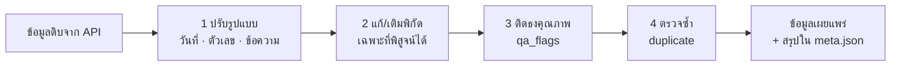

# วิธีทำความสะอาดข้อมูล (Data cleaning)

เอกสารนี้อธิบายทุกขั้นตอนที่ระบบทำกับข้อมูลดิบก่อนเผยแพร่ เพื่อให้ตรวจสอบและทำซ้ำได้

## หลักการ

1. **ไม่ลบ ไม่เดาค่า** — ทุกแถวจากต้นทางถูกเก็บไว้ ถ้ามีปัญหาจะ *ติดธง* (`qa_flags`) แทนการลบ
2. **แก้เฉพาะที่พิสูจน์ได้** — แก้ค่าเมื่อมีหลักฐานจากข้อมูลเองเท่านั้น (เช่น ค่า UTM ยืนยันได้ว่าโซนผิด) และเก็บค่าเดิมไว้เสมอ (`orig_*`, `utm_zone`, `raw_text`)
3. **ให้ผู้ใช้เลือกเอง** — เว็บและ notebook มีตัวกรองตามธง เช่น "พิกัดเชื่อถือได้" หรือ "ไม่มีปัญหา"
4. **ทำซ้ำได้** — การทำความสะอาดทั้งหมดอยู่ในโค้ด ([`scripts/fetch_ldd.py`](../scripts/fetch_ldd.py), [`scripts/fetch_osd.py`](../scripts/fetch_osd.py)) และรันใหม่ทุกครั้งที่ดึงข้อมูล



---

## A. จุดสำรวจดิน (LDD Soil Survey Public)

### A1. ปรับรูปแบบ (normalise)

| ฟิลด์ต้นทาง | ปัญหา | วิธีจัดการ | ฟิลด์ผลลัพธ์ |
|---|---|---|---|
| `Date` | รูปแบบ `dd/mm/yyyy` (ค.ศ.) | แปลงเป็น ISO `yyyy-mm-dd` ถ้าแปลงไม่ได้เก็บค่าเดิม | `date` |
| `Coordinate` | ข้อความ `"X:272336.000, Y:1845479.000"` หรือ `"X:-, Y:-"` | แยกเป็นตัวเลข ค่า `-` ให้เป็น `null` | `utm_x`, `utm_y` |
| `h_lat`, `h_lon` | เป็นข้อความ บางจุดว่าง | แปลงเป็นตัวเลข ถ้าอยู่นอกกรอบประเทศไทย (lat 5–21, lon 97–106) ให้เป็น `null` | `lat`, `lon` |
| ข้อความทุกฟิลด์ | มีช่องว่างหัว/ท้าย | `strip()` ค่าว่างให้เป็น `null` | |
| `pH`, `OM`, `P`, `K` | เป็นระดับ (เช่น "กรดจัด", "ต่ำ") และมี `Other` | เก็บตามต้นทาง (ไม่แปลงเป็นตัวเลข) `Other` ติดธง | `ph`, `om`, `p`, `k` |

### A2. พิกัด — ปัญหาโซน UTM

ประเทศไทยอยู่ใน UTM โซน 47 (ตะวันตกของ 102°E) และ 48 (ตะวันออก) จังหวัดอย่างขอนแก่นคร่อมทั้งสองโซน

**สิ่งที่พบ (ขอนแก่น 902 จุด):**

| กรณี | จำนวน | สาเหตุ |
|---|---|---|
| มี lat/lon จาก LDD และถูกต้อง | 230 | — |
| มี lat/lon จาก LDD แต่ **อยู่ชายแดนพม่า (~97°E)** | 120 | LDD แปลงด้วยโซน 47 แต่ค่า X เป็นโซน 48 → แก้ได้ 117, เหลือ 3–4 จุดติดธง |
| ไม่มี lat/lon แต่มี UTM | 513 | ฟิลด์โซนระบุ 47 (หรือว่าง) แต่ค่า X เป็นโซน 48 |
| ไม่มีพิกัดเลย | 39 | — |

ตรวจสอบแล้วว่า lat/lon ของ LDD ตรงกับค่า UTM ที่ให้มาภายใน 1 km ทุกจุด (โดยใช้โซนที่ LDD ระบุ) แสดงว่า LDD แปลงถูกสูตร แต่ **ฟิลด์โซนผิด**

**วิธีแก้** (`fill_from_utm`):

1. หาค่ากลางของจังหวัด (median lat/lon ของจุดที่ LDD ให้พิกัดมา) ใช้ median เพราะทนต่อค่าผิดปกติ
2. สำหรับจุดที่ (ก) ไม่มี lat/lon หรือ (ข) มี lat/lon แต่ห่างจากค่ากลางเกิน 1.4° (~150 km):
   - แปลง UTM → WGS84 ด้วย **ทั้งโซน 47 และ 48**
   - ตัดผลที่อยู่นอกประเทศไทย
   - เลือกผลที่ใกล้ค่ากลางจังหวัดที่สุด
3. รับผลเฉพาะเมื่อ:
   - กรณี (ข) ผลใหม่ต้องอยู่ภายใน 1.4° ของจังหวัด (ถ้าไม่ผ่าน คงค่าเดิมและติดธง `far_from_province`)
   - กรณี (ก) ผลต้องอยู่ภายใน 2.5°
4. บันทึก: `coord_source = "utm"`, โซนที่ใช้จริงใน `utm_zone_fixed`, ค่าเดิมของ LDD ใน `orig_lat`/`orig_lon`

สูตรแปลงเป็น Transverse Mercator มาตรฐาน (WGS84) ใน `utm_to_latlon()` ไม่ต้องใช้ไลบรารีภายนอก

> ⚠️ สมมติว่า datum เป็น WGS84 ถ้าข้อมูลต้นทางใช้ Indian 1975 พิกัดจะคลาดประมาณ 300–400 ม.

### A3. ธงคุณภาพ (`qa_flags`)

| ธง | เงื่อนไข | ขอนแก่น |
|---|---|---|
| `no_coords` | ไม่มี lat/lon และแปลง UTM ไม่ได้ | 39 |
| `utm_converted` | พิกัดได้จากการแปลง UTM (รวมที่แก้จาก LDD) | 630 |
| `utm_zone_fixed` | โซนที่ใช้ ≠ โซนที่ระบุ | 630 |
| `ldd_coords_fixed` | lat/lon ของ LDD ผิดโซน แก้แล้ว | 117 |
| `far_from_province` | ห่างจากค่ากลางจังหวัด > 1.4° หลังแก้แล้ว | 4 |
| `province_mismatch` | จังหวัดท้าย `location` ≠ จังหวัดที่ค้นหา | 0 |
| `no_location` | ไม่มีชื่อตำแหน่ง | 695 |
| `date_missing` | ไม่มีวันที่หรือแปลงไม่ได้ | 0 |
| `date_future` | วันที่สำรวจ > วันนี้ | 0 |
| `date_too_old` | ก่อนปี 1960 | 18 |
| `ph_unknown` | pH เป็น `Other`/ว่าง | 28 |
| `nutrient_unknown` | OM/P/K อย่างน้อยหนึ่งค่าเป็น `Other`/ว่าง | 831 |
| `duplicate` | lat/lon (5 ตำแหน่ง) + วันที่ ซ้ำกับจุดที่ id น้อยกว่า | 31 |

ตัวเลขล่าสุดของทุกจังหวัดอยู่ใน [`data/meta.json`](../data/meta.json) → `qa`

### A4. การเทียบรอบ (change detection)

ทุกจุดมี `src_hash` = SHA-1 ของแถวดิบจาก API (ก่อนทำความสะอาด) จุดจะถูกนับว่า "แก้ไข" เมื่อ `src_hash` เปลี่ยนเท่านั้น ดังนั้นการปรับกฎทำความสะอาด (เช่น แก้โซน UTM) หรือฟิลด์ที่ระบบสร้างเอง (`first_seen`, `qa_flags` ฯลฯ) จะไม่ถูกนับว่าเป็นการแก้ไขข้อมูลที่ต้นทาง

---

## B. ผลวิเคราะห์ดิน (LDD osd101)

### B1. ปรับรูปแบบ

| ฟิลด์ต้นทาง | ปัญหา | วิธีจัดการ |
|---|---|---|
| `date` | ข้อความไทย พ.ศ. `"23 กันยายน พ.ศ. 2569"` | แปลงชื่อเดือนไทย และ พ.ศ. − 543 → `2026-09-23` |
| `parameter` | มี HTML เช่น `อินทรียวัตถุ<sup>1/</sup> (OM) %` | ตัด tag แล้วจับคู่ด้วยรหัส `(pH)`, `(EC)`, `(OM)`, `(P)`, `(K)` |
| `value` | เป็นข้อความ บางค่าไม่ใช่ตัวเลข | แปลงเป็นตัวเลข ถ้าไม่ได้ ให้เก็บข้อความเดิมใน `raw_text` และติดธง |
| `latitude`/`longitude` | ข้อความ ทศนิยม 3 ตำแหน่ง (±100 m) บางค่าเป็น 0 | แปลงเป็นตัวเลข ค่า 0 ให้เป็น `null` |

### B2. ทำไมไม่สร้าง "ตัวอย่าง" ขึ้นเอง

API คืน 1 แถวต่อ 1 ค่าวัด และ **ไม่มีรหัสตัวอย่าง** ตอนแรกลองจับกลุ่มแถวที่ติดกันเป็นตัวอย่าง แต่พบว่าถ้าที่เดียวกันมีหลายตัวอย่างในวันเดียว แถวจะ **สลับกัน** เช่น

```
pH 6.7 · OM 0.56 · OM 0.40 · K 17 · K 17 · P 1 · P 0 · P 0 · OM 0.41 · pH 5.3 · ...
```

จึงบอกไม่ได้ว่า pH 6.7 คู่กับ OM ค่าไหน ถ้าจับคู่เองจะเป็นการ **สร้างข้อมูลที่ไม่มีจริง** ระบบจึงเก็บสองระดับ:

| ระดับ | ไฟล์ | ความหมาย |
|---|---|---|
| **measurement** | `measurements_<ปี>.csv.gz` | 1 แถว = 1 ค่าวัด ตามต้นทางทุกประการ |
| **site** | `sites_<ปี>.json`, `sites.csv` | 1 แถว = ที่ตั้ง + วันที่ มี `n` (จำนวนค่าวัด), median, min, max ของแต่ละพารามิเตอร์ |

- `id` ของ measurement = SHA-1 ของ (วันที่, พิกัด, ที่ตั้ง, พารามิเตอร์, ค่า, ลำดับของค่าที่เหมือนกันทุกอย่าง) ทำให้ค่าซ้ำจริงยังเก็บครบ และดึงช่วงเดิมซ้ำได้ id เดิม (กันข้อมูลซ้ำ)
- `id` ของ site = SHA-1 ของ (วันที่, พิกัด, ที่ตั้ง)
- ค่าที่นอกช่วงเป็นไปได้ **ไม่นำไปคำนวณ** median แต่ยังอยู่ในไฟล์ measurement
- จะวิเคราะห์ระดับตัวอย่างให้ใช้ site ที่ `n_samples = 1` (ไม่กำกวม)

### B3. ธงคุณภาพ (ระดับ site)

| ธง | เงื่อนไข |
|---|---|
| `no_coords` | ไม่มีพิกัดหรือเป็น 0 |
| `outside_thailand` | พิกัดนอกกรอบประเทศไทย |
| `date_invalid` | แปลงวันที่ไม่ได้ |
| `date_future` | วันที่ > วันนี้ (พบจริงใน API) |
| `value_non_numeric` | มีค่าที่ไม่ใช่ตัวเลข (ข้อความเดิมอยู่ใน `value_text`) |
| `value_out_of_range` | pH ∉ [2, 11], EC ∉ [0, 50] dS/m, OM ∉ [0, 100] %, P ∉ [0, 5000], K ∉ [0, 10000] mg/kg |
| `incomplete` | ไม่มีค่าวัดของพารามิเตอร์ใดพารามิเตอร์หนึ่ง |
| `multi_sample` | ที่เดียวกันวันเดียวกันมีหลายตัวอย่าง ค่าที่แสดงเป็น median |

### B4. ข้อจำกัดของการดึง

- API คืนได้สูงสุด 1,000 แถวต่อคำขอ ระบบขอทีละเดือน ถ้าเต็มจะแตกเป็นรายวัน
- ถ้า **วันเดียว** เกิน 1,000 แถว จะดึงไม่ครบ (API ไม่รองรับการกรองจังหวัดร่วมกับวันที่) วันเหล่านี้ถูกบันทึกใน [`data/osd/state.json`](../data/osd/state.json) → `capped_days`

---

## ใช้ข้อมูลที่ทำความสะอาดแล้ว

```python
import pandas as pd
df = pd.read_json("data/ldd/points.json")

# พิกัดเชื่อถือได้
BAD = {"no_coords", "far_from_province", "duplicate"}
good_xy = df[df["qa_flags"].apply(lambda f: not (set(f) & BAD))]

# ไม่มีธงเลย (เข้มที่สุด)
strict = df[df["qa_flags"].str.len() == 0]
```

ดูตัวอย่างเพิ่มใน notebook (เก็บในเครื่อง) หรือกรองบนเว็บที่เมนู **คุณภาพข้อมูล**
